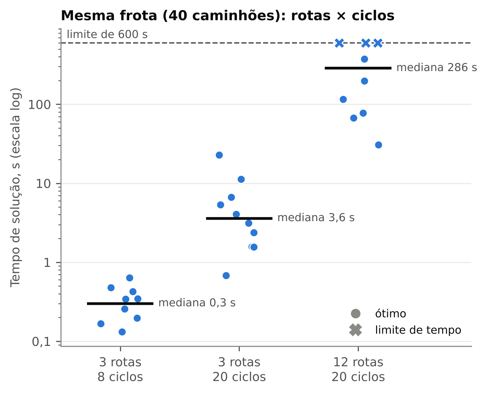
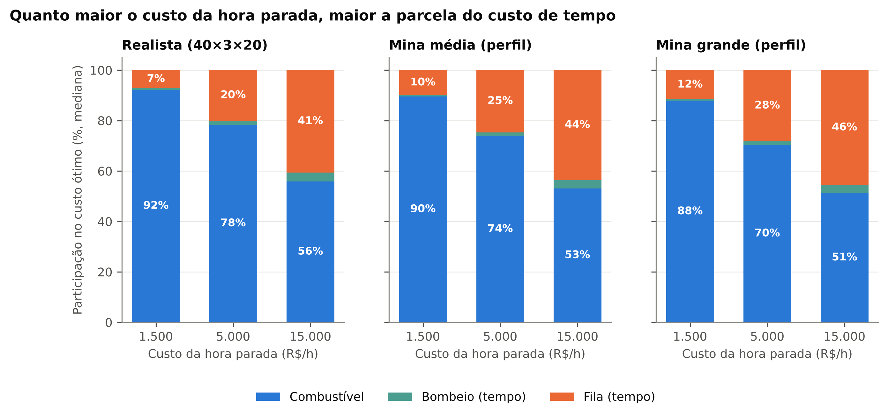

# Mine Fleet Fueling Optimization

**English** | [Português](README.pt-BR.md)


A mixed-integer linear programming (MILP) model that decides, **for a heterogeneous fleet of haul trucks in an open-pit mine, which route each truck runs and when and how much it refuels** over a full shift, minimizing fuel plus downtime cost.

Developed as the final project of the Operations Research course (Systems Engineering, Universidade Federal de Minas Gerais, 2026). The full paper (in Portuguese) is in [`docs/artigo_abastecimento_frota_mina.pdf`](docs/artigo_abastecimento_frota_mina.pdf).

---

## Highlights

- **Integrated formulation.** Truck-to-route assignment and refueling decisions (where to stop and how many liters to buy) are solved together, tracking each truck's fuel level across consecutive cycles with a safety reserve at every arrival.
- **70 reproducible instances**, from 5 to 95 trucks, 2 to 20 routes and 4 to 20 cycles per shift. Parameter ranges were calibrated on aggregated real operational data (the raw data is confidential).
- **62/70 instances solved to proven optimality** with Gurobi within 600 s. The remaining 8 stopped with gaps of 0.05% to 1.11%.
- **Exact validation by decomposition.** An independent truck × route decomposition (solved with HiGHS) reached the same cost on all 70 instances, which shows that those 8 solutions were already optimal and only the optimality proof was missing.
- **Independent verifier.** Every solution is re-simulated without the solver (fuel levels, reserve, tank capacity, demand and cost) and all 148 solutions passed.
- **Sensitivity analysis.** When the cost of an idle hour rises from R$ 1,500 to R$ 15,000, the median share of queueing in total cost grows from 7–12% to 41–45%, and reusing the base-case plan costs up to 7.4% more (median, large mine).

## The problem

Haul trucks run continuous load → dump → return cycles on routes with fuel stations along the way. Fuel consumption depends on the truck, the segment, and whether it travels loaded or empty, so each truck's tank evolves differently. Every stop prevents the tank from dropping below the safety reserve, but costs time (fixed queue plus pumping). Because the fleet is heterogeneous, **the route a truck is assigned to changes how often it must refuel**, so the two decisions have to be made jointly.

## Mathematical model

Each cycle is split into $P = \max_r |S_r|$ positions, and global position $t = 1,\dots,CP$ indexes arrivals over the shift.

| Variable | Domain | Meaning |
|---|---|---|
| $x_{k,r}$ | binary | truck $k$ is assigned to route $r$ |
| $y_{k,t,r}$ | binary | truck $k$ stops at position $t$ of route $r$ |
| $q_{k,t,r}$ | $\ge 0$ | liters bought by truck $k$ at position $t$ of route $r$ |
| $v_{k,t}$ | $\ge 0$ | fuel level of truck $k$ on arrival at position $t$ |

$$
\min \sum_{k}\sum_{r}\sum_{t \in T_r} \left( \Pi_{r,p(t)}\, q_{k,t,r} + F_{r,p(t)}\, y_{k,t,r} \right)
$$

subject to

$$
\begin{aligned}
& v_{k,1} = I_k - \textstyle\sum_r g_{k,r,p(1)}\, x_{k,r} && \text{initial level} \\
& v_{k,t} = v_{k,t-1} + \textstyle\sum_r q_{k,t-1,r} - \sum_r g_{k,r,p(t)}\, x_{k,r} && \text{fuel balance across cycles} \\
& L_k \le v_{k,t} \le Q_k && \text{safety reserve and tank capacity} \\
& q_{k,t,r} \le (Q_k - L_k)\, y_{k,t,r} && \text{buy only when stopping} \\
& v_{k,t} + \textstyle\sum_r q_{k,t,r} \le Q_k && \text{no overfilling} \\
& \textstyle\sum_r x_{k,r} = 1, \quad \sum_k x_{k,r} \ge D_r && \text{assignment and minimum demand per route} \\
& y_{k,t,r} \le x_{k,r} && \text{stops only on the assigned route}
\end{aligned}
$$

$\Pi$ is the cost per liter (fuel price + idle-hour cost × pumping time), $F$ is the fixed queue cost of a stop and $g_{k,r,p}$ is the consumption of truck $k$ on the segment arriving at position $p$, computed from loaded/empty distances, speeds and consumption rates. The full derivation and modeling discussion are in Section 3 of the paper.

## Method

| Step | Tool | Purpose |
|---|---|---|
| Instance generator | NumPy (fixed seeds) | Synthetic, reproducible, feasible by construction |
| Integrated MILP | Gurobi 14 (branch-and-cut) | Exact solution, 1 thread, 0.01% gap, 600 s limit |
| Solution verifier | Pure Python | Re-simulates tanks and cost without the solver |
| Decomposition | SciPy `milp` (HiGHS) | One subproblem per (truck, route) pair + assignment problem; certifies optimality |
| Baseline policy | Pure Python | "Refuel only when the next segment would break the reserve", for comparison |

Because queues are fixed per station, once a truck's route is fixed its refueling plan does not depend on the other trucks. This is what makes the exact decomposition possible.

## Results

| Instance group | Trucks × routes × cycles | Optimal | Median time (s) | Max gap |
|---|---|---|---|---|
| Small | 5 × 2 × 4 | 10/10 | 0.01 | ≤ 0.01% |
| Medium | 15 × 3 × 6 | 10/10 | 0.05 | ≤ 0.01% |
| Large | 40 × 3 × 8 | 10/10 | 0.30 | ≤ 0.01% |
| Realistic | 40 × 3 × 20 | 10/10 | 3.60 | ≤ 0.01% |
| Realistic, 12 routes | 40 × 12 × 20 | 6/10 | 286 | 1.11% |
| Mid-size mine (profile) | 11–30 × 3–8 × 8–19 | 10/10 | 1.48 | ≤ 0.01% |
| Large mine (profile) | 32–95 × 8–20 × 9–20 | 6/10 | 188 | 0.64% |

<p align="center">
  
</p>

With the fleet fixed at 40 trucks, going from 8 to 20 cycles raises the median solve time 12× and going from 3 to 12 routes raises it another 79×. Solve time correlates strongly with the number of binary variables (0.95 on a log scale).

Compared with the simple refueling rule, under the same assignment, optimizing the stops cut total cost by **0.83%**. With a single fuel price, the liters a truck needs on a given route are fixed, so stop optimization can only act on queue and pumping time. That explains why the gain is modest.

### Sensitivity to the idle-hour cost

<p align="center">
  
</p>

- A 10× more expensive idle hour increases total cost by only 1.68× to 1.98×, because fuel is still a large part of the cost.
- The number of stops barely changes. The model shifts trucks toward routes with cheaper stops and buys more liters per stop.
- Re-optimizing pays off when downtime is expensive. Keeping the base plan at R$ 15,000/h costs a median of 1.25% (realistic), 3.47% (mid-size mine) and 7.41% (large mine) more, with a maximum of 20.2%.

More figures are in [`figures/main`](figures/main) and [`figures/sensitivity`](figures/sensitivity).

## Repository structure

```
├── src/
│   ├── fleet_fueling_optimizer.py   # instance generator, Gurobi model, verifier, experiments
│   ├── sensibilidade_custo_hora.py  # sensitivity to the idle-hour cost
│   ├── validacao_decomposicao.py    # exact decomposition (HiGHS) + baseline rule
│   ├── graphics.py                  # figures and summary table for the main experiments
│   └── graficos_sensibilidade.py    # figures and table for the sensitivity analysis
├── instances/                       # 70 instances (inst_<group>_<seed>.json)
├── results/                         # raw CSV outputs (main runs, sensitivity, validation)
├── figures/
│   ├── main/                        # performance and cost figures + summary table
│   └── sensitivity/                 # sensitivity figures + table
├── docs/
│   └── artigo_abastecimento_frota_mina.pdf
├── requirements.txt
└── LICENSE
```

## Reproducing the results

Requires Python 3 and, for the optimization runs, a Gurobi license. The free academic license covers every instance; the size-limited pip license only handles the small and medium groups. Run everything from the repository root.

```bash
pip install -r requirements.txt

# Instance generator only (no Gurobi needed)
python src/fleet_fueling_optimizer.py diagnostico

# Quick test on a 5×2×4 instance
python src/fleet_fueling_optimizer.py teste

# All 70 instances -> results/resultados.csv and instances/
python src/fleet_fueling_optimizer.py experimentos

# Figures and summary table -> figures/main/
python src/graphics.py

# Sensitivity to the idle-hour cost
python src/sensibilidade_custo_hora.py realista    --saida results/sensibilidade_custo_hora.csv
python src/sensibilidade_custo_hora.py mina_media  --saida results/sens_mina_media.csv
python src/sensibilidade_custo_hora.py mina_grande --apenas-fechadas --tempo 1800 --saida results/sens_mina_grande.csv
python src/graficos_sensibilidade.py               # -> figures/sensitivity/

# Exact validation by decomposition (no Gurobi needed)
python src/validacao_decomposicao.py principal     # -> results/validation/
python src/validacao_decomposicao.py resumo
```

Instances are deterministic: the same group and seed always generate the same data. The figure scripts and the decomposition summary only read the CSVs in `results/`, so they can be rerun without Gurobi.

Original experiments ran on an Intel Core i7-1165G7 (4 cores), 16 GB RAM (15.7 GB usable), Windows 11, Python 3.12.4, Gurobi 14.0.0 and SciPy 1.13.1. Solve times near the 600 s limit may vary slightly between runs.

## Assumptions and limitations

A single shift in which every truck runs the same number of cycles and stays on its route. Queues are deterministic and fixed per station (no congestion), the fuel price is uniform, production is not part of the objective, and fuel left in the tank at the end of the shift is not valued. The idle-hour cost (R$ 1,500/h) and pumping rate (600 L/min) are estimates, which is why the sensitivity analysis was run. See Section 5.6 of the paper.

## Authors

- **Samuel Lima Horta**: [GitHub](https://github.com/samucao1803)
- **Julia Martins dos Santos**
- **Matheus Guedes Belloni**

Systems Engineering, Universidade Federal de Minas Gerais (UFMG), Belo Horizonte, Brazil.

## License

[MIT](LICENSE)
