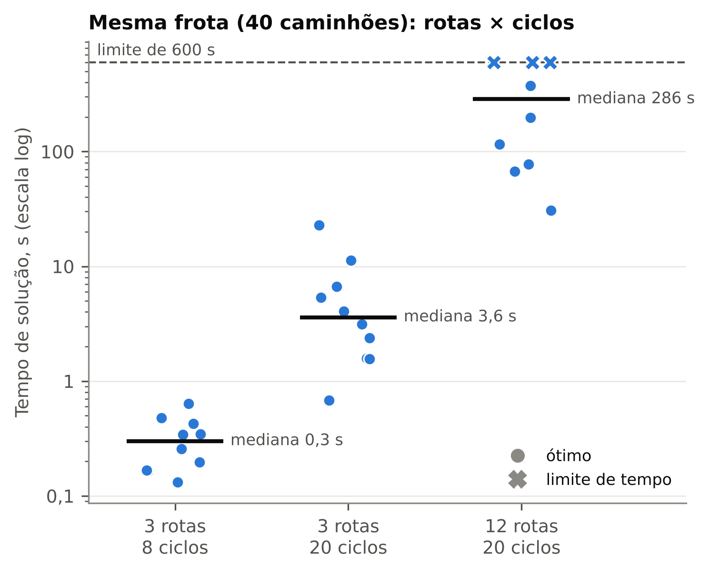
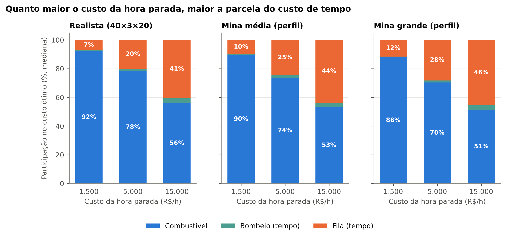

# Otimização do Abastecimento de Frota em Mina

[English](README.md) | **Português**


Modelo de programação linear inteira mista (PLIM) que decide, **para uma frota heterogênea de caminhões em uma mina a céu aberto, a rota de cada caminhão e quando e quanto ele deve abastecer** ao longo do turno, minimizando o custo de combustível e de tempo parado.

Trabalho final da disciplina de Pesquisa Operacional (Engenharia de Sistemas, Universidade Federal de Minas Gerais, 2026). O artigo completo está em [`docs/artigo_abastecimento_frota_mina.pdf`](docs/artigo_abastecimento_frota_mina.pdf).

---

## Destaques

- **Formulação integrada.** A alocação de caminhões a rotas e as decisões de abastecimento (onde parar e quantos litros comprar) são resolvidas juntas, acompanhando o nível de combustível de cada caminhão entre ciclos consecutivos, com reserva de segurança em toda chegada.
- **70 instâncias reprodutíveis**, de 5 a 95 caminhões, 2 a 20 rotas e 4 a 20 ciclos por turno. As faixas dos parâmetros foram calibradas com dados operacionais agregados (os dados brutos são sigilosos).
- **62 de 70 instâncias resolvidas com otimalidade provada** pelo Gurobi em até 600 s. As outras 8 pararam com gap de 0,05% a 1,11%.
- **Validação exata por decomposição.** Uma decomposição independente por par caminhão-rota (resolvida com o HiGHS) chegou ao mesmo custo nas 70 instâncias. Isso mostra que aquelas 8 soluções já eram ótimas e faltava apenas a prova de otimalidade.
- **Verificador independente.** Toda solução é refeita sem o solver (níveis do tanque, reserva, capacidade, demanda e custo), e as 148 soluções foram aprovadas.
- **Análise de sensibilidade.** Quando o custo da hora parada sobe de R$ 1.500 para R$ 15.000, a participação mediana da fila no custo passa de 7–12% para 41–45%, e reaproveitar o plano do caso-base custa até 7,4% a mais (mediana, mina de grande porte).

## O problema

Os caminhões fazem ciclos contínuos de carga → descarga → retorno em rotas com postos de abastecimento ao longo do caminho. O consumo depende do caminhão, do trecho e de o deslocamento ser carregado ou vazio, então o tanque de cada caminhão evolui de um jeito. Cada parada evita que o nível fique abaixo da reserva de segurança, mas custa tempo (fila fixa e bombeamento). Como a frota é heterogênea, **a rota atribuída a um caminhão muda a frequência com que ele precisa abastecer**, e por isso as duas decisões precisam ser tomadas em conjunto.

## Modelo matemático

Cada ciclo é dividido em $P = \max_r |S_r|$ posições, e a posição global $t = 1,\dots,CP$ indexa as chegadas ao longo do turno.

| Variável | Domínio | Significado |
|---|---|---|
| $x_{k,r}$ | binária | caminhão $k$ alocado à rota $r$ |
| $y_{k,t,r}$ | binária | caminhão $k$ para na posição $t$ da rota $r$ |
| $q_{k,t,r}$ | $\ge 0$ | litros comprados pelo caminhão $k$ na posição $t$ da rota $r$ |
| $v_{k,t}$ | $\ge 0$ | nível do caminhão $k$ ao chegar à posição $t$ |

$$
\min \sum_{k}\sum_{r}\sum_{t \in T_r} \left( \Pi_{r,p(t)}\, q_{k,t,r} + F_{r,p(t)}\, y_{k,t,r} \right)
$$

sujeito a

$$
\begin{aligned}
& v_{k,1} = I_k - \textstyle\sum_r g_{k,r,p(1)}\, x_{k,r} && \text{nível inicial} \\
& v_{k,t} = v_{k,t-1} + \textstyle\sum_r q_{k,t-1,r} - \sum_r g_{k,r,p(t)}\, x_{k,r} && \text{balanço de combustível entre ciclos} \\
& L_k \le v_{k,t} \le Q_k && \text{reserva e capacidade do tanque} \\
& q_{k,t,r} \le (Q_k - L_k)\, y_{k,t,r} && \text{compra só quando há parada} \\
& v_{k,t} + \textstyle\sum_r q_{k,t,r} \le Q_k && \text{sem ultrapassar o tanque} \\
& \textstyle\sum_r x_{k,r} = 1, \quad \sum_k x_{k,r} \ge D_r && \text{alocação única e demanda mínima por rota} \\
& y_{k,t,r} \le x_{k,r} && \text{paradas só na rota escolhida}
\end{aligned}
$$

$\Pi$ é o custo por litro (preço do combustível + custo da hora parada × tempo de bombeamento), $F$ é o custo fixo de fila de uma parada e $g_{k,r,p}$ é o consumo do caminhão $k$ no trecho que chega à posição $p$, calculado a partir das distâncias carregado e vazio, das velocidades e das taxas de consumo. A dedução completa e a discussão da modelagem estão na Seção 3 do artigo.

## Método

| Etapa | Ferramenta | Função |
|---|---|---|
| Gerador de instâncias | NumPy (seeds fixas) | Dados sintéticos, reprodutíveis e viáveis por construção |
| PLIM integrado | Gurobi 14 (branch-and-cut) | Solução exata, 1 thread, gap de 0,01%, limite de 600 s |
| Verificador | Python puro | Refaz tanques e custo sem usar o solver |
| Decomposição | SciPy `milp` (HiGHS) | Um subproblema por par (caminhão, rota) + problema de designação; certifica a otimalidade |
| Regra de referência | Python puro | "Abastecer só quando o próximo trecho violaria a reserva", para comparação |

Como a fila é fixa por posto, depois que a rota de um caminhão é fixada, o plano de abastecimento dele não depende dos outros caminhões. É isso que torna possível a decomposição exata.

## Resultados

| Grupo | Caminhões × rotas × ciclos | Ótimas | Tempo mediano (s) | Gap máx. |
|---|---|---|---|---|
| Pequena | 5 × 2 × 4 | 10/10 | 0,01 | ≤ 0,01% |
| Média | 15 × 3 × 6 | 10/10 | 0,05 | ≤ 0,01% |
| Grande | 40 × 3 × 8 | 10/10 | 0,30 | ≤ 0,01% |
| Realista | 40 × 3 × 20 | 10/10 | 3,60 | ≤ 0,01% |
| Realista, 12 rotas | 40 × 12 × 20 | 6/10 | 286 | 1,11% |
| Mina de médio porte (perfil) | 11–30 × 3–8 × 8–19 | 10/10 | 1,48 | ≤ 0,01% |
| Mina de grande porte (perfil) | 32–95 × 8–20 × 9–20 | 6/10 | 188 | 0,64% |

<p align="center">
  
</p>

Com a frota fixa em 40 caminhões, passar de 8 para 20 ciclos aumenta a mediana do tempo em 12 vezes, e passar de 3 para 12 rotas aumenta em mais 79 vezes. O tempo de solução tem correlação forte com o número de variáveis binárias (0,95 em escala logarítmica).

Em relação à regra simples de abastecimento, mantida a mesma alocação, a otimização das paradas reduziu o custo total em **0,83%**. Com preço único, os litros que um caminhão precisa em uma rota são fixos, então a otimização das paradas só atua sobre o tempo de fila e de bombeamento. Por isso o ganho é modesto.

### Sensibilidade ao custo da hora parada

<p align="center">
  
</p>

- Com a hora parada 10 vezes mais cara, o custo total sobe só de 1,68 a 1,98 vez, porque o combustível continua sendo boa parte do custo.
- O número de paradas quase não muda. O modelo realoca caminhões para rotas com paradas mais baratas e compra mais litros por parada.
- Reotimizar compensa quando o tempo parado é caro. Manter o plano do caso-base a R$ 15.000/h custa, na mediana, 1,25% (realista), 3,47% (mina média) e 7,41% (mina grande) a mais, com máximo de 20,2%.

Outras figuras estão em [`figures/main`](figures/main) e [`figures/sensitivity`](figures/sensitivity).

## Estrutura do repositório

```
├── src/
│   ├── fleet_fueling_optimizer.py   # gerador de instâncias, modelo Gurobi, verificador e experimentos
│   ├── sensibilidade_custo_hora.py  # sensibilidade ao custo da hora parada
│   ├── validacao_decomposicao.py    # decomposição exata (HiGHS) + regra de referência
│   ├── graphics.py                  # figuras e tabela-resumo dos experimentos principais
│   └── graficos_sensibilidade.py    # figuras e tabela da sensibilidade
├── instances/                       # 70 instâncias (inst_<grupo>_<seed>.json)
├── results/                         # CSVs brutos (experimentos, sensibilidade, validação)
├── figures/
│   ├── main/                        # figuras de desempenho e custo + tabela-resumo
│   └── sensitivity/                 # figuras e tabela da sensibilidade
├── docs/
│   └── artigo_abastecimento_frota_mina.pdf
├── requirements.txt
└── LICENSE
```

## Como reproduzir

Requer Python 3 e, para a otimização, uma licença do Gurobi. A licença acadêmica gratuita cobre todas as instâncias; a licença limitada instalada pelo pip só resolve os grupos pequeno e médio. Rode tudo a partir da raiz do repositório.

```bash
pip install -r requirements.txt

# Só o gerador de instâncias (não precisa do Gurobi)
python src/fleet_fueling_optimizer.py diagnostico

# Teste rápido em uma instância 5×2×4
python src/fleet_fueling_optimizer.py teste

# As 70 instâncias -> results/resultados.csv e instances/
python src/fleet_fueling_optimizer.py experimentos

# Figuras e tabela-resumo -> figures/main/
python src/graphics.py

# Sensibilidade ao custo da hora parada
python src/sensibilidade_custo_hora.py realista    --saida results/sensibilidade_custo_hora.csv
python src/sensibilidade_custo_hora.py mina_media  --saida results/sens_mina_media.csv
python src/sensibilidade_custo_hora.py mina_grande --apenas-fechadas --tempo 1800 --saida results/sens_mina_grande.csv
python src/graficos_sensibilidade.py               # -> figures/sensitivity/

# Validação exata por decomposição (não precisa do Gurobi)
python src/validacao_decomposicao.py principal     # -> results/validation/
python src/validacao_decomposicao.py resumo
```

As instâncias são determinísticas: o mesmo grupo e a mesma seed sempre geram os mesmos dados. Os scripts de figuras e o resumo da decomposição só leem os CSVs de `results/`, então podem ser rodados sem o Gurobi.

Os experimentos originais rodaram em um Intel Core i7-1165G7 (4 núcleos), 16 GB de RAM (15,7 GB utilizáveis), Windows 11, Python 3.12.4, Gurobi 14.0.0 e SciPy 1.13.1. Tempos perto do limite de 600 s podem variar um pouco entre execuções.

## Hipóteses e limitações

Um único turno, em que todos os caminhões fazem o mesmo número de ciclos e permanecem na rota atribuída. A fila é determinística e fixa por posto (sem congestionamento), o preço do combustível é único, a produção não entra no objetivo e o combustível que sobra no fim do turno não é valorado. O custo da hora parada (R$ 1.500/h) e a taxa de bombeamento (600 L/min) são estimativas, por isso a análise de sensibilidade. Veja a Seção 5.6 do artigo.

## Autores

- **Samuel Lima Horta**: [GitHub](https://github.com/samucao1803)
- **Julia Martins dos Santos**
- **Matheus Guedes Belloni**

Engenharia de Sistemas, Universidade Federal de Minas Gerais (UFMG), Belo Horizonte, Brasil.

## Licença

[MIT](LICENSE)
